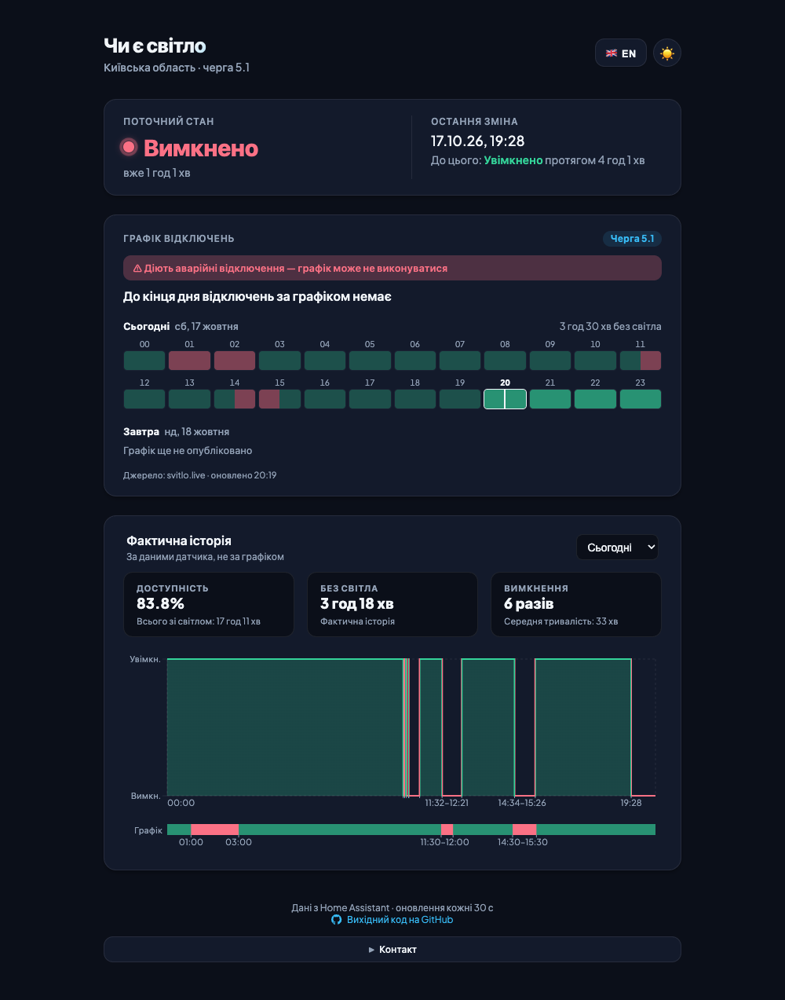
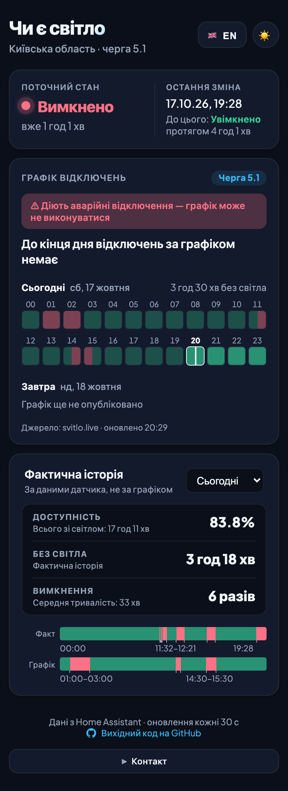
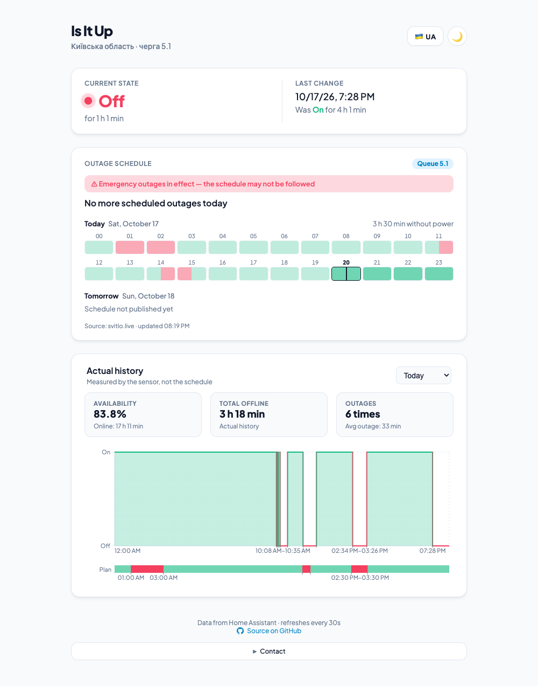
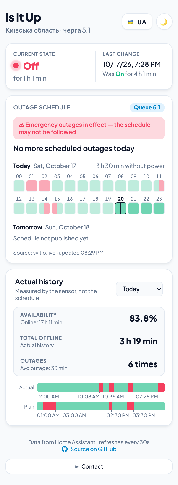

# Is It Up — grid power status page

**English** · [Українська](README.uk.md)

A small, mobile-first status page that answers one question for you and your neighbours: **is there power right now?**
It reads a grid power sensor from [Home Assistant](https://www.home-assistant.io/) and shows the current state, when it last changed, the actual outage history, and — optionally — DTEK's planned outage schedule side by side with what really happened.

Made for a residential complex in Ukraine during scheduled and emergency blackouts. Pretty much fully AI-generated, built for fun, but in daily use.

<table>
  <tr>
    <td width="68%"></td>
    <td width="32%"></td>
  </tr>
  <tr>
    <td></td>
    <td></td>
  </tr>
</table>

## Why

Home Assistant knows when the power goes out, but you don't want to give neighbours access to it. This app is a read-only public window onto a single sensor: the HA token stays on the server, and HA itself can stay on your home network or behind a VPN.

## Features

- **Current state** — on / off and for how long, plus the last change and how long the previous state lasted. Short `unavailable` blips in HA (e.g. while a template sensor reloads) don't break an outage into pieces.
- **Outage schedule** (optional) — today and tomorrow as an hour grid like DTEK's (each hour split into half-hours), the next scheduled outage with a countdown.
- **DTEK alerts** (optional) — banners when emergency outages are in effect in the region (the schedule may not be followed), and when DTEK reports an emergency, planned or scheduled outage at your address, with its estimated restoration. The two happen independently, so either or both can show.
- **Actual history** — today, yesterday, or the last 6 h … 7 days, with availability, total time without power, number of outages and their average length.
  - On a computer: a step chart with a **Plan** lane under it, so you can see at a glance whether outages followed the schedule.
  - On a phone: two compact lanes, **Actual** and **Plan**, on one time scale. Turn the phone to landscape to get the full chart.
  - **All periods** — an expandable list with every on/off period in the range: start – end, state, duration.
  - Outage start/end times are labelled under both, in pairs (never just a start or just an end); outages too short for a label still get a tick mark.
- **Phone-friendly** — compact layout, no hover-only UI, refreshes as soon as you come back to the tab, and can be added to the home screen as an app.
- Light / dark theme (follows the system), English / Ukrainian, refreshes every 30 s.

## How it works

```
Browser ──► nginx (frontend, :3033) ──/api──► FastAPI (backend, :8033) ──REST──► Home Assistant
                                                                    └──────► DTEK schedule (outage-data-ua)
```

- The **backend** is a thin proxy over the Home Assistant REST API (`/api/states`, `/api/history/period`). The browser never sees the HA token.
- **Grid sensor** — any HA `binary_sensor` whose state is `on` when there's power and `off` when there isn't. For example: a template sensor built from a UPS "on battery" status, a ping sensor for a device that isn't on backup power, or a smart plug's availability.
- **History** comes from the HA recorder, so how far back you can look is HA's `purge_keep_days` (10 days by default), not something this app controls. Time before the sensor's first record is shown as "No data" — never guessed.
- **Schedule** — DTEK's own schedule, as on its sites and in its bot; no HA integration needed:
  - DTEK has no public API and its sites are behind bot protection, so it's read from [outage-data-ua](https://github.com/Baskerville42/outage-data-ua), which copies it every few minutes. Covers Kyiv city, Kyiv region, Dnipro and Odesa;
  - the backend fetches it every 5 minutes;
  - every version of each day it sees is saved to `data/schedule.json` (a Docker volume), so past days show the schedule as it was in effect at the time — including changes during the day. That history starts when you first run the app with the schedule configured;
  - whether emergency outages are in effect in the region comes from the DTEK proxy behind svitlo.live — the only place that flag is published (ignored when it's out of date).

- **What DTEK reports for your address** (optional) — from the [DTEK Monitor](https://github.com/groove-max/ha-dtek-monitor) HACS integration (Kyiv region and other DTEK regions; it looks up your address on DTEK's site): an emergency / planned / scheduled outage with DTEK's estimated restoration time, shown as a banner. Nothing is shown when DTEK reports nothing — accidents announced elsewhere don't necessarily show up there (nor in DTEK's bot).

## Setup

### 1. Home Assistant

1. A grid power `binary_sensor` (see above).
2. A long-lived access token: your HA profile → **Security** → **Long-lived access tokens**.

### 2. Run with Docker

```bash
cp .env.example .env   # then fill in HA_BASE_URL, HA_TOKEN, GRID_ENTITY_ID (+ SCHEDULE_REGION, SCHEDULE_QUEUE)
docker compose up -d --build
```

Open **http://localhost:3033**. The frontend's nginx proxies `/api` to the backend.
If the backend runs in Docker and HA is on the host's LAN, use `http://host.docker.internal:8123` or the HA IP.

### Environment variables

**Backend**

| Variable | Description | Example |
|---|---|---|
| `HA_BASE_URL` | Home Assistant URL | `http://192.168.1.10:8123` |
| `HA_TOKEN` | Long-lived access token | — |
| `GRID_ENTITY_ID` | Grid power binary sensor | `binary_sensor.grid_power` |
| `SCHEDULE_REGION` | *Optional.* DTEK region: `kyiv-region`, `kyiv`, `dnipro` or `odesa` (`kiivska-oblast` etc. still work); with `SCHEDULE_QUEUE`, enables the schedule card and the Plan lane | `kyiv-region` |
| `SCHEDULE_QUEUE` | *Optional.* Your queue | `5.1` |
| `ADDRESS_ENTITY_ID` | *Optional.* "Outage status" sensor of the [DTEK Monitor](https://github.com/groove-max/ha-dtek-monitor) integration for your address: shows what DTEK reports for it (see above) | `sensor.dtek_krem_<id>_outage_status` |
| `SCHEDULE_EMERGENCY_API_URL` | *Optional.* DTEK proxy, only for the region's emergency outages flag. Empty = never shown | `https://dtek-api.svitlo-proxy.workers.dev/` (default) |
| `SCHEDULE_DTEK_URL` | *Optional.* DTEK schedule JSON (outage-data-ua format). Derived from `SCHEDULE_REGION` if unset | `https://raw.githubusercontent.com/Baskerville42/outage-data-ua/main/data/kyiv-region.json` |
| `DATA_DIR` | Where the recorded schedule is kept | `data` (`/data`, a volume, in Docker) |

**Frontend** (optional, baked in at build time; passed as Docker build args)

| Variable | Description | Example |
|---|---|---|
| `VITE_APP_SUBTITLE` | Line under the title, e.g. your address or queue | `Kyiv region · queue 5.1` |
| `VITE_CONTACT_EMAIL` | Email in the Contact section (hidden if unset) | `you@example.com` |
| `VITE_GITHUB_REPO_URL` | Link to the repo in the footer | `https://github.com/...` |
| `VITE_BASE_PATH` | Base path if served from a subpath | `/` or `/is-it-up/` |
| `VITE_API_BASE` | Path to the API on the same host | `/api` |

Behind a reverse proxy (e.g. Nginx Proxy Manager), set `VITE_BASE_PATH` and `VITE_API_BASE` to the paths you route to the frontend and the backend.

### Add to the home screen

Open the page on your phone → **Share → Add to Home Screen** (iPhone) or the browser menu → **Add to Home screen** (Android). It opens like an app, without the address bar.

## Local development

```bash
# backend (needs HA_BASE_URL / HA_TOKEN / GRID_ENTITY_ID, e.g. `set -a; . ../.env; set +a`)
cd backend
poetry install
poetry run uvicorn app.main:app --reload --port 8000

# frontend (the Vite dev server proxies /api to localhost:8000)
cd frontend
npm install
npm run dev
npm run build   # tsc + vite build — the only type check
```

## API

| Endpoint | Description |
|---|---|
| `GET /health` | Health check |
| `GET /api/state` | Current state of the grid sensor |
| `GET /api/last-change` | Last on/off change and how long the previous state lasted (ignoring `unavailable` blips) |
| `GET /api/history?hours=N` | State changes for a rolling window, `N` ∈ 6, 12, 24, 48, 72, 168 |
| `GET /api/history?start=<ISO>[&end=<ISO>]` | Same for a fixed window (with a timezone offset; max 168 h; `end` defaults to now). Includes `schedule_history` — the recorded schedule before today — when a schedule is configured |
| `GET /api/schedule` | DTEK's planned outages for today and tomorrow (Kyiv time), DTEK's update time and the region's emergency flag; `{"enabled": false}` if not configured |
| `GET /api/address` | What DTEK reports for the address (DTEK Monitor): status, description, start, estimated restoration; `{"enabled": false}` if not configured |

## Tech stack

- **Backend:** Python 3.11+, FastAPI, httpx, pydantic-settings, Poetry
- **Frontend:** React 18, Vite, TypeScript, Recharts
- **Deploy:** Docker Compose (backend + frontend on nginx)
